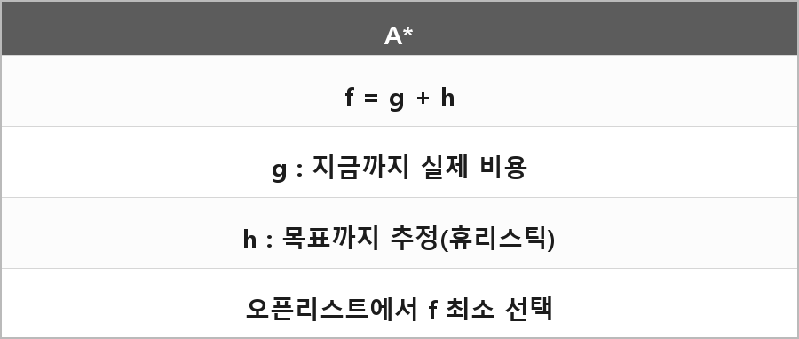

# A*

  

> `f = g + h` 로 경로를 탐색한다.

| 기호 | 의미 |
| --- | --- |
| **g** | 지금까지 실제 이동 비용 |
| **h** | 목표까지 추정 비용 (휴리스틱) |
| **f** | 경로를 평가할 때 쓰는 점수 |

오픈 리스트에서 **f가 가장 작은 노드**를 고른다.
방문한 노드는 클로즈드 리스트에 넣는다.
휴리스틱으로 목표에 가까운 길을 먼저 보니까 최단 경로를 효율적으로 찾는다.

## 단점

- 모든 노드를 관리해야 해서 연산 비용이 크다
- 휴리스틱에 의존적이라 나온 길이 반드시 최적이라고 장담하기 어렵다
- 장애물이 동적으로 바뀌면 탐색을 자주 다시 해야 해서 비효율적일 수 있다

포트폴리오에 물방울 퍼즐로 쓰려던 이유: 최단 거리를 찾고 그 거리를 시각화해서, 레버로 칸막이를 조절해 탈출시키는 스테이지.

---

> [!NOTE]
> **보충**
>
> **원 논문:** Hart, Nilsson, Raphael, "A Formal Basis for the Heuristic Determination of Minimum Cost Paths", IEEE Trans. SSC, 1968.
>
> h가 **허용적**(admissible, 실제 남은 비용을 과대평가하지 않음)이면 A*는 최적 경로를 찾는다.
> "휴리스틱에 따라 최적이 보장되지 않는다"는 h가 허용적이지 않을 때 이야기다.
> 면접에선 이 조건을 같이 말하는 게 맞다.
>
> 맨해튼/유클리드는 그리드에서 h로 많이 쓴다. → `Manhattan-Euclidean.md`
