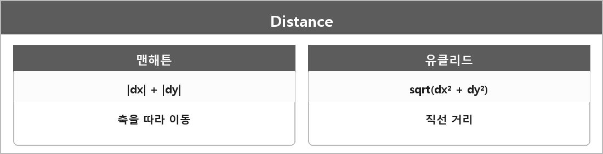

# 맨해튼 거리 / 유클리드 거리

  

> 맨해튼 거리는 축을 따라 이동한 거리이고, 유클리드 거리는 두 점 사이의 직선 거리다.

그리드에서 대각선이 없으면 맨해튼이 A* 휴리스틱으로 잘 맞다.
대각선 이동이 있으면 유클리드나 옥타일.

---

> [!NOTE]
> **보충**
>
> 유클리드: sqrt((x2-x1)^2 + (y2-y1)^2)
> 맨해튼: |x2-x1| + |y2-y1|
>
> 이건 정의라서 논문까지 갈 필요 없다.
