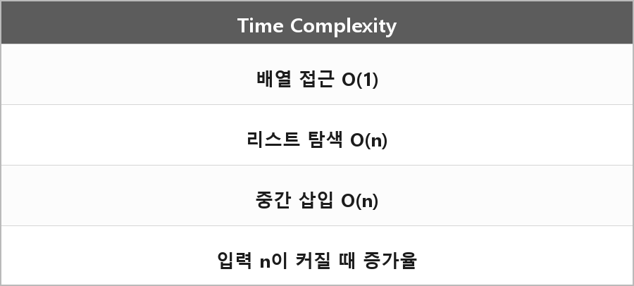

# 시간복잡도

  

> 시간 복잡도는 입력 크기에 따라 알고리즘이 걸리는 연산량을 나타내며, 보통 빅오 표기로 증가율을 표현한다.

배열 인덱스 O(1), 연결리스트 탐색 O(n), 중간에 배열 삽입 O(n)이 그 표기다.

---

> [!WARNING]
> **더 보충이 필요한 부분**
>
> 최선/평균/최악, 공간 복잡도, amortized는 정리에 없다.
> 빅오만 있으면 질문 입구는 통과하고, 해시 최악이나 vector 재할당을 말하면 amortized가 필요하다.
> 출처는 CLRS 점근 표기 챕터.
