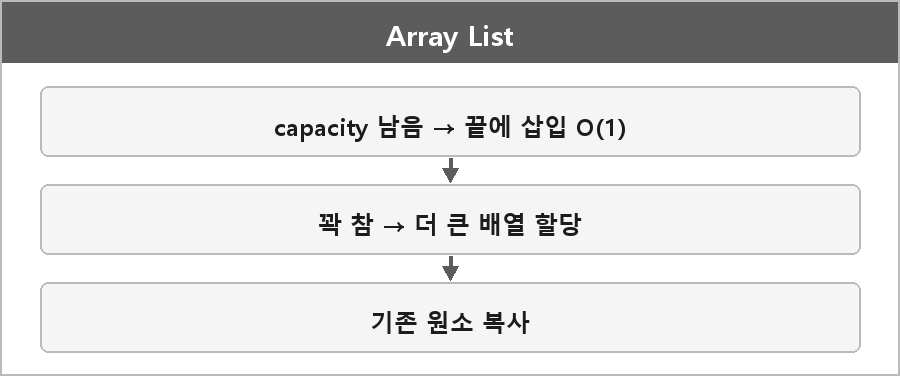

# 배열리스트

  

> 동적 배열 형태의 자료구조로, 요소의 개수가 유동적으로 변할 수 있는 배열이다. 일반적인 배열과 달리 크기가 자동으로 조정되기 때문에 삽입과 삭제에 더 유연하다.

데이터를 연속 메모리에 저장해서 인덱스 접근은 O(1)이다.
크기를 조정하거나 중간에 삽입/삭제하면 O(n)이다.

C#에서는 List<T>가 이 계열이다. 요소 추가 시 용량이 부족하면 더 큰 배열을 잡아 복사한다.
C++ vector도 같다.

> [!TIP]
> **여담**
>
> 작동 방식이 쉽게 생각해서 동적으로 배열에 요소가 추가되면 그 요소가 추가되거나 제거된 배열을 새로 만들어서 복사하는 거다.
>
> 매 삽입마다 새로 만드는 건 아니다. 용량(capacity)이 남아 있으면 그냥 끝에 넣는다.
> 용량이 꽉 찼을 때만 더 큰 배열을 할당하고 복사한다. 보통 두 배.

---

> [!NOTE]
> **보충**
>
> amortized O(1) push_back이 그 이야기다.
> - **출처:** C++ [vector.capacity] — 재할당 시 용량은 구현이 정한 성장 계수를 따른다. MSVC/libstdc++는 보통 1.5 또는 2배.
> C# List<T> 공식 문서: 기본 용량을 넘으면 현재 용량의 두 배로 증가.
