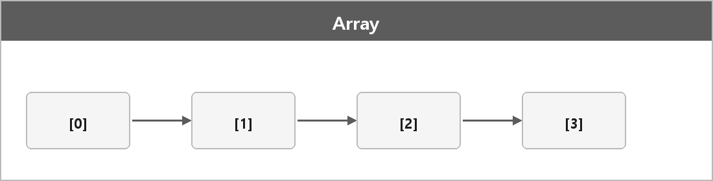

# 배열

  

> 같은 데이터 타입의 요소들을 연속적으로 저장하는 자료구조다. 배열은 고정된 크기와 연속된 메모리 공간을 가지며, 각 요소는 인덱스를 통해 빠르게 접근할 수 있다.

### 장점

인덱스를 이용한 O(1) 접근. 메모리에 연속이라 캐시 효율이 높다.

### 단점

크기가 고정되어 동적 크기 변경이 어렵고, 삽입/삭제는 O(n).

고정된 개수의 데이터, 연속 처리에 쓴다.
