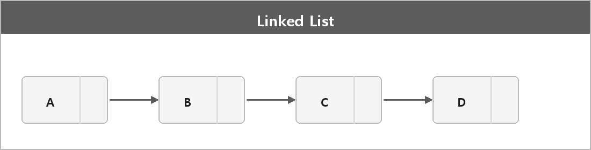

# 연결리스트

  

> 연결 리스트는 노드로 이루어진 자료구조로, 각 노드는 데이터와 다음 노드에 대한 포인터를 포함하고 있다.
>
> 동적으로 메모리를 할당하므로 배열과 달리 크기가 유동적이고, 요소를 삽입하거나 삭제할 때 O(1)의 시간 복잡도를 가지며 효율적이다.
>
> 하지만 임의의 위치에 접근하려면 처음부터 순차적으로 접근해야 하므로 접근은 O(n)이다.
>
> 단일, 이중, 원형 연결 리스트가 있다.

> [!TIP]
> **여담**
>
> 노드는 데이터를 저장하는 공간이자, 다른 노드의 메모리 주소를 저장하는 포인터가 구조에 따라 1개 이상 가지고 있는 단위다.

> [!TIP]
> **여담**
>
> 연결 리스트는 쉽게 말해서 책을 예시로 들면 페이지를 넘기는 것이다. 단방향은 뒤로만, 양방향은 앞뒤로, 원형은 다 읽으면 처음 페이지로 돌아온다.
>
> 삽입/삭제가 O(1)인 건 이미 그 노드 포인터를 가지고 있을 때다.
> n번째를 찾아서 지우는 건 찾는 데 O(n)이다.
>
> shared_ptr로 양방향 리스트를 만들면 순환 참조가 난다. Smart-Pointer.md.
