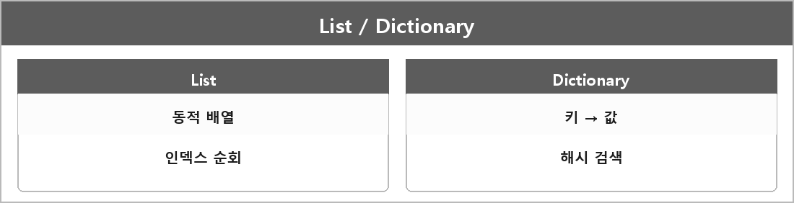

# List / Dictionary

  

> List는 동적 배열로 데이터의 삽입, 삭제가 용이한 선형 자료구조. 유니티에서는 주로 컬렉션을 저장하거나 순차적으로 처리하는데 사용된다.

Dictionary는 키값으로 데이터를 저장하는 자료구조.
유니티에서는 특정 키로 데이터를 빠르게 검색하거나 관리할 때 사용된다.

C# List는 Array-List.md 그거고, Dictionary는 해시 테이블 계열이다.
평균 검색 O(1), 최악은 해시 충돌에 따라 O(n).

---

> [!WARNING]
> **더 보충이 필요한 부분**
>
> 해시 함수, 충돌 처리(체이닝 vs 오픈 어드레싱)는 정리에 없다.
> Dictionary 성능 질문이 나오면 이게 필요하다.
> .NET Dictionary 공식 문서에 구현 힌트가 있다. 필요하면 그거 보고 적으면 된다.
