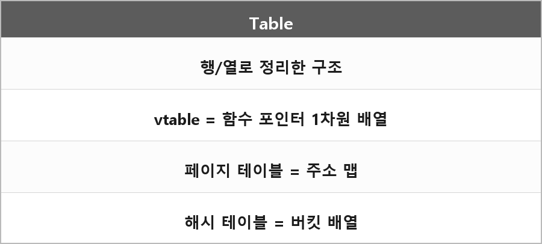

# 테이블

  

> 테이블은 그냥 행과 열로 정리한 구조를 말하는 거다.
>
> 포인터의 배열인 거지 그렇다고 선형 배열은 아니다.
>
> 루트, 점프, 페이지 테이블 등등의 테이블은 배열으로 쓰인다.
>
> 해시맵, 트리 스트럭쳐, 커넥트 등 리스트 형태일 때도 있음.
>
> 하지만 가상함수 테이블은 1차원 배열이 맞다.

이름에 테이블이 붙었다고 자료구조가 하나로 고정된 게 아니다.
페이지 테이블은 배열(또는 다단계 배열), vtable도 함수 포인터 배열, 해시 테이블은 버킷 배열 + 충돌 처리.
