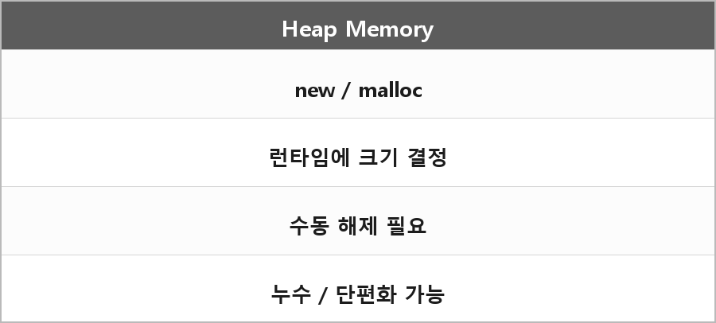

# 힙 메모리

  

> 힙은 동적 할당을 통해 더 큰 메모리를 다룰 수 있지만 수동 관리가 필요해서 누수나 단편화가 일어날 수 있다. 런 타임에 크기가 결정되는 것들이 들어가는 것.

new/malloc이 여기서 온다.
수명이 함수 범위를 넘어야 하거나 크기를 실행 중에 알 때 쓴다.
해제를 안 하면 누수고, 할당/해제를 반복하면 구멍이 나서 단편화가 생긴다.

C++에선 스마트 포인터나 RAII로 해제를 객체 수명에 묶는다.
