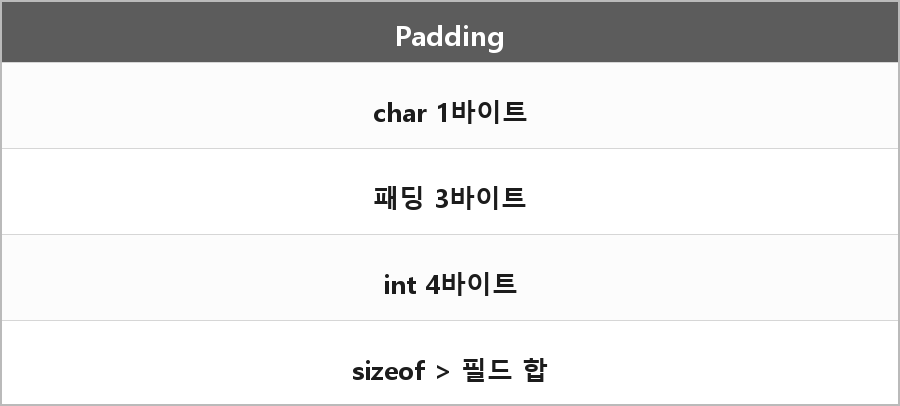

# 메모리 패딩

  

> CPU의 데이터 정렬 기준에 맞춰서 빈공간을 삽입하는 것으로 접근속도는 빨라지지만 메모리 사용량이 늘어난다.

구조체에서 char 다음에 int가 오면, int를 4바이트 경계에 맞추려고 사이에 패딩이 들어간다.
그래서 필드 합보다 sizeof가 크다.

---

> [!NOTE]
> **보충**
>
> 정렬은 구현체/ABI가 정한다.
> x64 Windows/System V 모두 기본 타입은 자기 크기에 맞춰 정렬하는 경우가 많다. (int는 4, pointer는 8)
>
> C/C++ 표준은 alignof, alignas, [basic.align]에서 정렬 요구를 말한다.
> 패딩을 프로그래머가 직접 넣는 게 아니라 컴파일러가 레이아웃에 넣는 거다.

---

> [!WARNING]
> **더 보충이 필요한 부분**
>
> `#pragma pack`으로 패딩을 없애면 크기는 줄지만 미정렬 접근이 느려지거나, 일부 아키텍처에선 문제가 된다.
> 네트워크 패킷 구조체에서 자주 나온다. 필요하면 MSVC pack 문서랑 [dcl.align]만 추가로 보면 된다.
