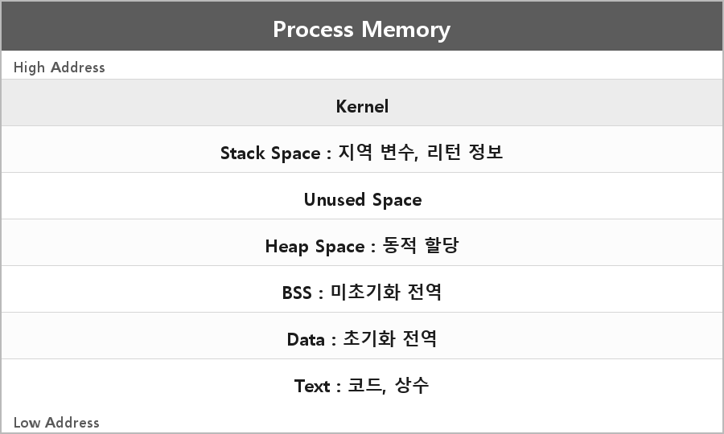

# 메모리 구조

<p align="center">
  
</p>

```
-------------- 커널 ---------------------------------------High Address
- Stack Space : 함수 호출 시 지역 변수, 리턴 정보
- Unused Space
- Heap Space : 동적 할당 메모리
- BSS Segment : 초기화 되지 않은 전역 변수
- Data Segment : 초기화 된 전역 변수
- Text Segment : 함수 코드, 제어문, 상수
------------------------------------------------------------Low Address
```

높은 주소에 스택, 낮은 주소에 코드.
힙은 위로, 스택은 아래로 자라면서 가운데 Unused를 나눠 쓰는 그림으로 많이 그린다.

---

> [!NOTE]
> **보충**
>
> 이건 OS/아키텍처마다 다른 전형적인 사용자 공간 그림이다.
> 리눅스 ELF에서 흔히 말하는 Text/Data/BSS 이름이다.
> Windows PE는 섹션 이름이 `.text` `.data` `.bss` 비슷한 역할이긴 한데, 커널이 프로세스 주소 공간 맨 위에 붙는 그림은 리눅스 32비트 사용자 공간 설명에 가깝다.
>
> 커널이 항상 그 그림처럼 같은 주소에 있는 건 아니다.
> 64비트 Windows는 사용자 공간/커널 공간 주소 범위가 따로 있다.

---

> [!WARNING]
> **더 보충이 필요한 부분**
>
> 내가 그린 그림은 "프로세스 가상 주소 공간의 흔한 교육용 레이아웃"이지, 모든 OS의 실제 맵은 아니다.
> Windows 기준으로 말하려면 Microsoft Learn Memory Management, PE 포맷 문서를 보고 섹션/힙/스택이 어떻게 잡히는지 따로 적어야 한다.
> 이유는 면접에서 "우리 환경(Windows) 기준으로 그려봐"가 나오면 ELF 그림만 그리면 안 맞아서다.
> 상수(문자열 리터럴)가 항상 Text에 있는 것도 아니다. 구현은 read-only data 섹션을 쓰기도 한다.
