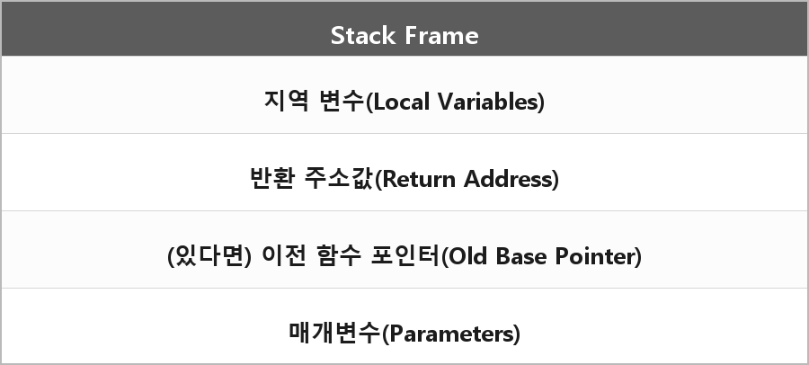

# 스택프레임

  

> 스택에서 데이터가 저장되는 **한 호출 단위**다.

## 구성

| 들어가는 것 | |
| --- | --- |
| 지역 변수 | Local Variables |
| 반환 주소값 | Return Address |
| (있다면) 이전 함수 포인터 | Old Base Pointer |
| 매개변수 | Parameters |

함수 호출이 끝나면 이 프레임은 없어진다.

## 재귀

스택 프레임이 없어지면 재귀는 어떻게 가능하냐.

컴퓨터 입장에서 함수는 모두 동일한 게 아니라 **호출마다 별도의 프레임**이다.
그래서 재귀는 호출될 때마다 프레임을 새로 만들기 때문에 가능하다.

호출될 때마다 프레임을 생성한다는 이야기처럼 오지게 잡아먹기 때문에 오버플로우에 취약하다.

> **여담**
>
> (니(나) 기준으로) 쓰지 마라. for문으로 대체 쌉가능이다.

---

> [!NOTE]
> **보충**
>
> **1MB는 스택 프레임 크기가 아니다.**
> Windows에서 링커가 예약하는 기본 스택 크기(스레드 스택 전체)가 1MB다.
>
> - **출처:** Microsoft Learn — Thread Stack Size  
>   `"The default stack reservation size used by the linker is 1 MB."`
> - **출처:** MSVC `/STACK`  
>   ARM64/x86/x64에서 기본 스택 크기 1MB
>
> 스택 프레임 하나는 그 함수 호출 한 번에 필요한 만큼이다. 몇십 바이트일 수도 있고 큰 지역 배열이면 훨씬 클 수도 있다.
> 1MB는 "이 스레드 스택이 최대로 쓸 수 있게 예약해 둔 공간"이다.
> 재귀가 위험한 이유는 프레임이 쌓여서 그 예약 한도에 닿기 때문이다.
>
> 프레임에 뭐가 들어가는지는 ABI마다 다르다.
> x64 Windows는 홈 스페이스, 리턴 주소, 저장한 레지스터 등.
> "전 함수 포인터"는 프레임 포인터(RBP)를 저장하는 경우다. 최적화하면 프레임 포인터를 안 쓰기도 한다.

---

> [!WARNING]
> **더 보충이 필요한 부분**
>
> - **무엇:** 호출 규약 (x64, `__cdecl`, 레지스터로 인자 몇 개)
> - **이유:** 매개변수 일부가 스택이 아니라 레지스터로 간다. 프레임을 정확하게 그리려면 Microsoft x64 calling convention 문서가 필요하다.
