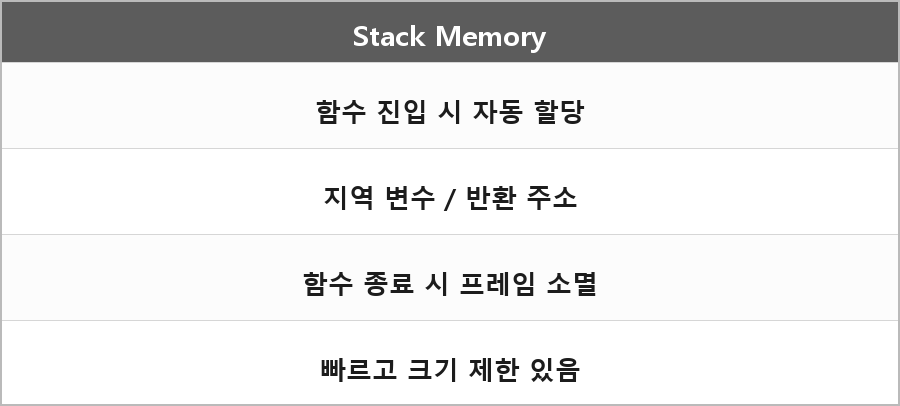

# 스택 메모리

  

> 스택은 함수 실행시 자동으로 할당되는 메모리로 빠르고 예측 가능하지만 크기가 제한적이다.
>
> 컴파일 타임에 크기가 결정되는 것들이 들어가는 것. 근데 사실 런타임에서도 굴러간다.
>
> 그래서 리턴 주소가 있는 것.

지역 변수, 반환 주소, 저장한 레지스터가 여기 쌓인다.
함수가 끝나면 그 프레임은 그냥 포인터만 되돌린다. free 호출이 아니다.
그래서 빠르다.

"컴파일 타임에 크기 결정"은 지역 배열 크기처럼 프레임 레이아웃이 컴파일 때 정해진다는 말에 가깝다.
alloca나 VLA(C)처럼 런타임에 프레임이 더 커지는 경우도 있다.
Windows 기본 스택 한도는 Stack-Frame.md에 적은 대로 보통 1MB 예약이다.
