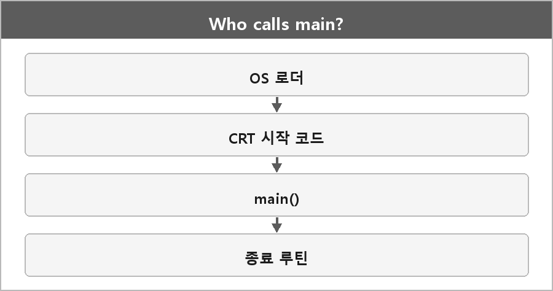

# CRT와 main 호출

  

> C/C++로 제작된 프로그램은 main()이 진입점으로 보인다. 누가 어떻게 호출하는가.

main은 운영체제가 직접 호출하는 게 아니라, 실행 시 로드된 CRT 초기화 코드가 준비 작업을 마친 뒤 main을 호출한다.
main이 끝나면 반환값은 OS에 전달되고 종료 루틴이 실행된다.

Windows GUI면 WinMain / wWinMain이 사용자 진입점인 경우가 있다. WinMain.md에 빈칸이 있다.

---

> [!NOTE]
> **보충**
>
> - **출처:** Microsoft Learn — CRT Initialization, main / WinMain
> PE 엔트리 포인트는 보통 `mainCRTStartup` / `WinMainCRTStartup` 같은 런타임 스타트업이다.
> 거기서 전역 생성자, 힙 초기화 같은 걸 한 뒤 main을 부른다.
> Linux도 비슷하게 libc가 `_start`에서 `main`을 부른다. System V ABI / glibc 스타트업.
>
> 운영체제가 직접 main 심볼을 찾는 그림은 아니다. 로더가 엔트리 포인트를 실행하고, 그 엔트리가 CRT다.
