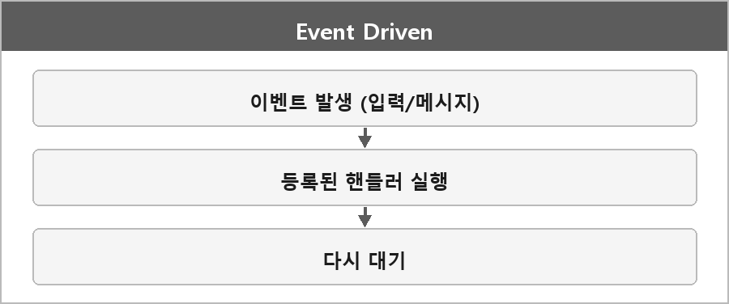

# 이벤트 기반 프로그래밍

  

> 이벤트 기반 프로그래밍은 사용자 입력이나 시스템 메시지가 발생할 때마다 미리 등록된 핸들러가 실행되는 방식이다. 윈도우 프로그래밍은 메시지 루프를 통해 이를 처리한다.

내가 매 프레임 입력을 폴링하는 방식이랑 반대 극단에 가깝다.
실제 게임은 메시지 루프 + 프레임 입력 상태를 같이 쓰는 경우가 많다. Input.md 참고.
