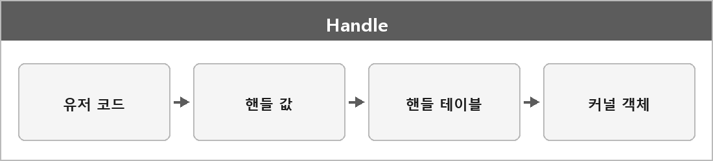

# 핸들

  

> 핸들은 윈도우에서 커널 객체를 직접 주소 대신 식별하는 값으로, 보안과 추상화를 위해 사용된다.

유저 모드에서 커널 객체 포인터를 바로 안 준다.
핸들 테이블을 거쳐야 하니까 잘못된 주소로 커널을 직접 찌르기 어렵다.

---

> [!NOTE]
> **보충**
>
> - **출처:** Microsoft Learn — Handles and Objects
> 프로세스는 핸들 테이블을 가지고, 핸들은 그 테이블의 인덱스에 가까운 값이다.
> 같은 커널 객체라도 프로세스마다 핸들 값이 다를 수 있다.
> CloseHandle로 닫는다.
