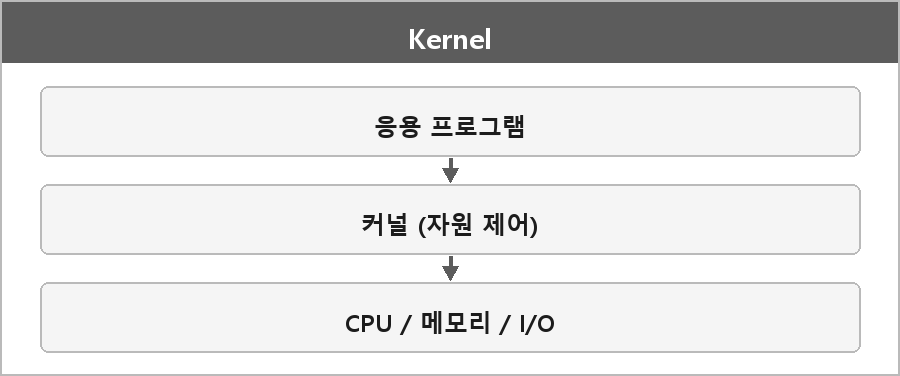

# 커널

  

> 커널은 운영체제의 핵심(Core) 구성 요소로, 하드웨어와 소프트웨어(응용 프로그램) 사이를 중재하는 역할을 하는 프로그램이다.
>
> 커널은 메모리, CPU, 저장장치, 입출력 장치 등 모든 하드웨어 자원을 직접 제어하고 관리하며, 사용자나 응용 프로그램이 요청한 작업(시스템 콜 등)을 안전하게 수행하도록 지원한다.

> [!TIP]
> **여담**
>
> 커널과 쉘의 차이점은 커널은 운영체제의 핵심 로직이고 쉘은 사용자 인터페이스.

---

> [!WARNING]
> **더 보충이 필요한 부분**
>
> 커널 모드/유저 모드 특권 링은 여기 정리에 거의 없다. User-vs-Kernel.md에 빈칸으로 적어 뒀다.
> 면접에서 "커널이 뭐냐" 다음에 바로 모드 전환이 나온다.
> Intel SDM의 privilege level, Windows의 user/kernel mode 문서를 보고 보충해야 한다.
> 이유는 시스템 콜이 그냥 함수 호출이 아니라 모드 전환이라서다.
