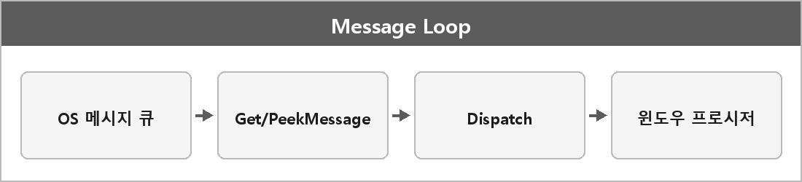

# 메시지 루프

  

> [!TIP]
> **여담**
>
> 메시지 루프를 사용하는 이유
> OS에서 전달되는 입력 윈도우 이벤트를 효율적으로 처리하기 위함이다.
> 이를 통해 사용자 입력과 렌더링이 자연스럽게 동기화 된다.
>
> 윈도우 프로그래밍이 이벤트 기반이라고 하는 이유가 이거다.
> 메시지 큐에서 메시지를 꺼내 윈도우 프로시저로 보낸다.

---

> [!NOTE]
> **보충**
>
> - **출처:** Microsoft Learn — Using Messages and Message Queues
> 전형적인 루프는 `GetMessage` / `PeekMessage` -> `TranslateMessage` -> `DispatchMessage`.
> GetMessage는 메시지가 없으면 대기하고, PeekMessage는 게임 루프처럼 렌더를 계속 돌릴 때 쓴다.
>
> "입력과 렌더가 자연스럽게 동기화된다"는 게임 루프에 PeekMessage를 넣는 이야기에 가깝다.
> GUI 앱의 GetMessage 루프는 메시지가 올 때까지 잠든다.
