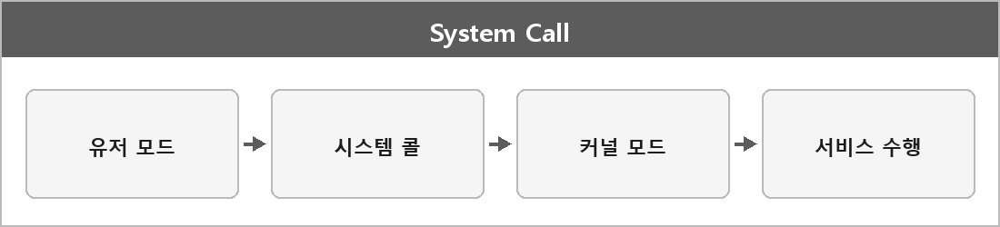

# 시스템 콜

  

> 시스템 콜(System Call)은 사용자 프로그램(응용 프로그램)이 운영체제의 커널이 제공하는 저수준 서비스(예: 파일 입출력, 프로세스 생성, 메모리 할당 등)를 직접 사용할 수 있도록 제공하는 인터페이스 함수다.

응용 프로그램은 커널 메모리를 직접 못 건드린다.
그래서 open, read, CreateFile 같은 창구로 요청한다.
호출하면 유저 모드에서 커널 모드로 넘어갔다가 다시 돌아온다.
