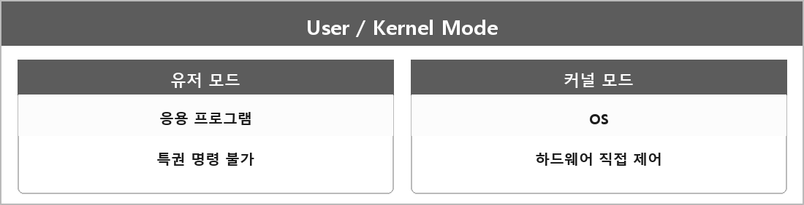

# 커널 영역과 유저 영역

  

> 원 정리에 내용이 거의 없다. 예상 질문에 "(어려움)"으로만 있다. 커널.md에 커널이 하드웨어를 직접 다룬다는 정도만 있다.

---

> [!WARNING]
> **더 보충이 필요한 부분**
>
> 무엇:
> - 유저 모드: 응용 프로그램. 특권 명령/커널 메모리 직접 접근 불가
> - 커널 모드: OS. 디바이스, 페이지 테이블, 스케줄러
> - 전환 지점: 시스템 콜, 인터럽트, 예외
>
> 왜 필요: 핸들, 시스템 콜, 크래시(접근 위반) 설명을 모드 없이 하면 반쪽이다.
>
> - **출처:** 
> - Intel SDM Volume 3 — Privilege Levels
> - Microsoft Learn — User mode and kernel mode
>
> 지금은 공식 문서를 읽고 한 장으로 다시 적어야 한다. 추측으로 안 채운다.
