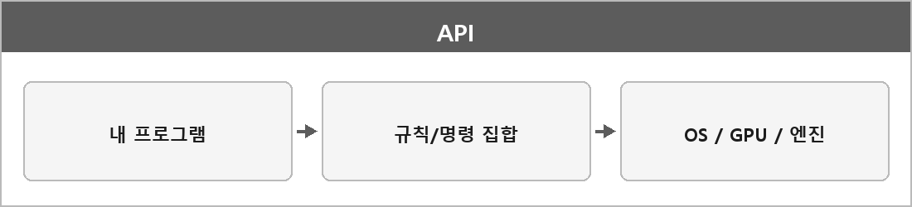

# API

  

### 정의

프로그램이 외부 시스템(운영체제, 그래픽 카드, 엔진 등)과 통신하기 위한 **규칙/명령 집합**이다.
하드웨어나 OS 기능을 안전하고 표준화된 방식으로 호출할 수 있게 해 준다.

### 예시

| API | 하는 일 |
| --- | --- |
| DirectX, OpenGL, Vulkan | GPU와 그래픽 기능에 접근 |
| Win32 API | 창 생성, 키보드 입력, 파일 I/O |

### 장단점

| 항목 | 설명 |
| --- | --- |
| **장점** | 하드웨어·OS를 직접 건드리지 않고 제어 가능 |
| **단점** | 저수준이라 배우기 어렵고 코드가 장황하다 |

비교하면 OS나 하드웨어가 제공하는 기능을 호출하는 규칙이다.

게임 개발 흐름으로 보면 DirectX 11로 GPU에 그리기 명령을 전달하는 쪽이 API다.

---

> [!NOTE]
> **보충**
>
> **출처:** ISO/IEC 2382 — API는 대략 "응용 프로그램이 다른 소프트웨어 구성요소의 서비스에 접근하기 위해 쓰는 인터페이스"
>
> 내가 정리한 "규칙/명령 집합"이랑 같은 말이다. 더 늘릴 필요는 없다.
