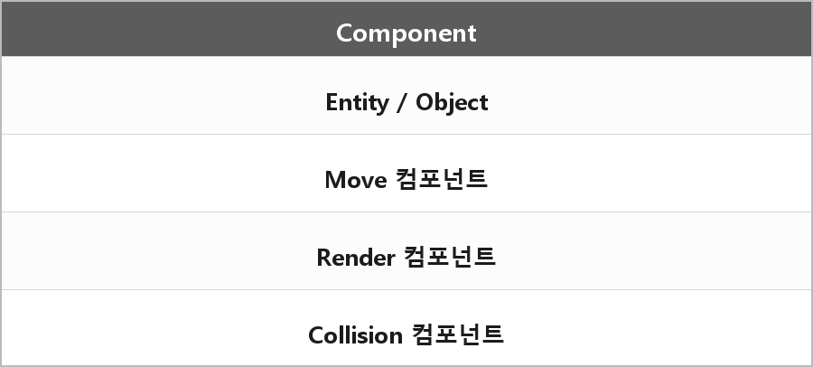

# 컴포넌트

  

> 컴포넌트 시스템은 기능별로 모듈화된 구조로, 독립성·재사용성을 보장하며 유지보수를 쉽게 만드는 설계 방식이다.
>
> 제 프로젝트에서는 string으로 된 이름과 Object 포인터를 소유자로 받아 Update나 Render를 수행한다.

컴포넌트 시스템은 독립적으로 개발·테스트 가능한 작은 기능 단위(컴포넌트)들을 조합하여 하나의 큰 시스템을 구성하는 설계 방식이다.
각 컴포넌트는 명확한 역할과 인터페이스를 갖고, 다른 컴포넌트와 최소한의 결합으로 상호작용한다.

게임 엔진에서는 엔티티에 붙여 위치·렌더링·충돌 같은 역할을 조합해 동작을 만든다.

Unity의 컴포넌트(콜라이더, 리지드바디, 스크립트)도 같은 생각이다.
