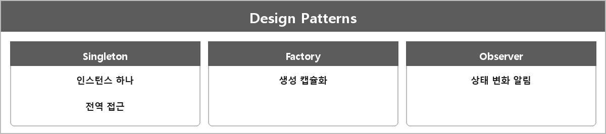

# 디자인 패턴

  

> 디자인 패턴은 소프트웨어 설계에서 자주 등장하는 문제 해결 방법을 정리한 템플릿이다.

예를 들어
- 싱글톤: 하나의 인스턴스만 유지해 전역적으로 사용. 로그나 설정 관리.
- 팩토리: 객체 생성 과정을 캡슐화
- 옵저버: 상태 변화를 다른 객체에 알림

싱글톤 상세는 Singleton.md.
std::function 보호할 때 말한 커맨드 패턴, 메시지 큐, 이벤트 버스도 여기 계열이다.

---

> [!NOTE]
> **보충**
>
> 패턴 이름은 GoF (Gamma et al., Design Patterns, 1994)에서 온 게 많다.
> C++ 표준 용어는 아니다.

---

> [!WARNING]
> **더 보충이 필요한 부분**
>
> 팩토리/옵저버 코드 스케치는 정리에 없다.
> 싱글톤만 자세히 있다.
> 면접에서 "왜 쓰냐"는 지금 문장으로 되고, "코드로 그려봐"면 그 둘을 따로 적어야 한다.
