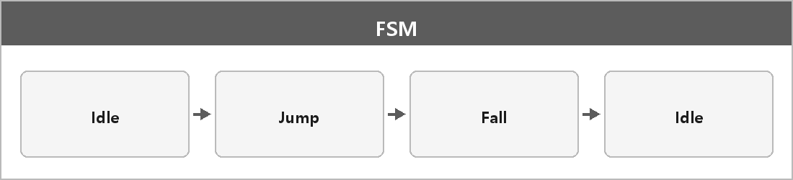

# FSM (유한 상태 기계)

  

> 유한 상태 기계는 한 번에 하나의 상태만 가지게 하는 것이다. 예를 들어 액션 게임에서 모션이 나올 때 구르는 모션과 막는 모션이 동시에 나올 수는 없듯이 하나의 상태만 가지게 하는 것이다.

상태마다 전이 조건이 있다. Idle에서 점프 키면 Jump, 착지하면 Idle.

---

> [!WARNING]
> **더 보충이 필요한 부분**
>
> Mealy/Moore, 계층 FSM, 비헤이비어 트리는 정리에 없다.
> 게임 AI를 깊게 물어보면 이 구분이 나온다.
> 지금은 "한 번에 상태 하나"면 질문 의도는 맞다.
