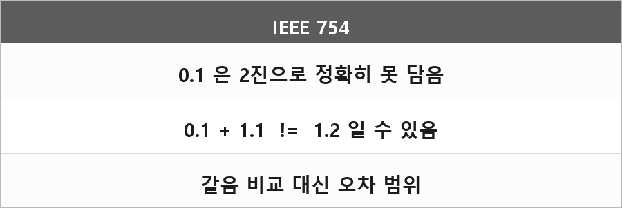

# 부동소수점 오차

  

> 원 정리에 내용이 없다. 예상 질문: 0.1+1.1은 왜 1.2가 아닌가.

---

> [!WARNING]
> **더 보충이 필요한 부분**
>
> 무엇: 이진 부동소수(IEEE 754)가 십진 소수를 전부 정확히 못 담아서 생기는 반올림 오차.
> 왜 필요: 본인이 어려운 질문으로 표시해 둠. 충돌 좌표, 타이머 비교에서 실제로 터진다.
>
> 보충할 내용:
> - IEEE 754 binary64/binary32. 출처: IEEE 754 표준
> - 0.1은 2진 순환소수라 근사값으로 저장
> - 같음 비교 대신 입실론, 또는 정수 틱/고정소수
>
> 지금은 표준 읽고 0.1의 저장 비트만 예로 적어야 한다. 추측 계산 안 넣는다.
