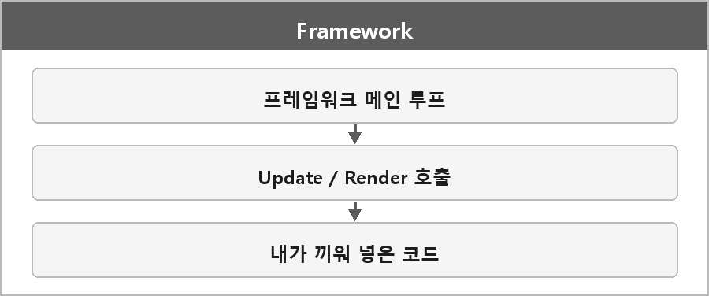

# 프레임워크

  

### 정의

**뼈대 코드.** 실행 흐름(메인 루프 등)을 프레임워크가 주도하고, 사용자가 거기에 코드를 끼워 넣는다.

특징은 **제어의 역전 (IoC)** 이다.

### 예시

| 프레임워크 | |
| --- | --- |
| Unity, Unreal Engine | 게임 전체 구조와 루프를 엔진이 가진다 |
| MonoGame, SDL | 기본 게임 루프와 이벤트 시스템 제공 |

### 장단점

| 항목 | 설명 |
| --- | --- |
| **장점** | 빠르게 전체 게임 구조를 잡고 개발 가능 |
| **단점** | 자유도가 낮고, 프레임워크가 정한 방식에 따라야 한다 |

비교하면 실행 구조를 제공하고, 내가 거기에 맞춰 코드를 작성하는 쪽이다.

게임 개발 흐름으로 보면 Unity가 메인 루프를 돌리면서 사용자가 `Update()`에 게임 로직을 넣는 게 프레임워크/엔진이다.

---

> [!WARNING]
> **더 보충이 필요한 부분**
>
> 프레임워크라는 단어 자체는 C++ 표준이나 OS 표준에 정의가 없다.
> 면접 핵심은 **"누가 제어 흐름을 가지느냐"**라서 지금 정리로 충분하다.
>
> SDL을 프레임워크로 넣을지 라이브러리로 넣을지는 사람마다 갈린다.
> SDL은 루프를 강제하지 않고 내가 `SDL_PollEvent`를 돌릴 수도 있어서다.
> 실제 사용 방식 보고 말하는 게 맞다.
