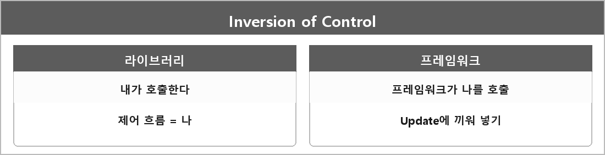

# 제어의 역전 (Inversion of Control, IoC)

  

> 그러니까 제어의 역전은 원래 코드가 필요할 때마다 라이브러리를 호출했는데 프레임워크나 엔진처럼 IoC가 적용된 구조는 Update나 Render를 프레임워크에서 루프로 돌리고 우리가 그 사이에 함수를 끼워넣는 구조다 이 말이다.

내가 라이브러리를 부르는 게 아니라, 프레임워크가 나를 부르는 거다.

---

> [!WARNING]
> **더 보충이 필요한 부분**
>
> IoC라는 말이 의존성 주입(DI)이랑 같이 나오기 시작하면 범위가 넓어진다.
> 내가 지금 쓰는 의미는 게임 루프/콜백 쪽이고, 스프링 같은 컨테이너의 DI까지는 정리에 없다.
> 면접에서 DI까지 물어보면 그때 따로 적어야 한다.
> 이유는 같은 단어로 다른 층을 가리키기 때문이다.
