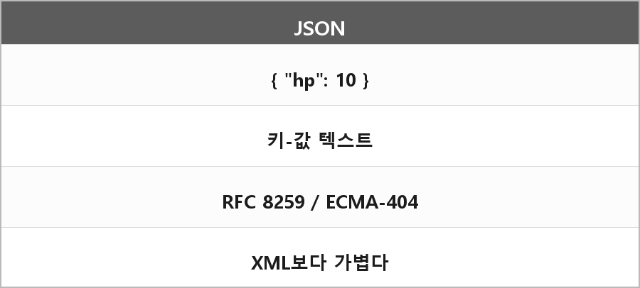

# JSON

  

> 원 정리에 본문이 없고, 예상 질문에 "xml과의 차이점을 설명할 수 있으면 더 좋다"만 있다.

---

> [!WARNING]
> **더 보충이 필요한 부분**
>
> 무엇: 텍스트 데이터 교환 포맷. 객체/배열/숫자/문자열/bool/null.
> 왜 필요: 세이브, 설정, 네트워크, 본인 예상 질문 목록에 있음.
>
> 보충할 내용:
> - JSON은 JavaScript Object Notation. 원 표준은 ECMA-404 / RFC 8259
> - XML은 태그, 속성, 스키마가 무겁고 JSON은 키-값이라 가볍다
> - 주석 없음(표준 JSON), 끝 콤마 없음
>
> 지금은 RFC 8259를 읽고 문법 예시 몇 줄만 적으면 된다. 추측으로 안 채운다.
