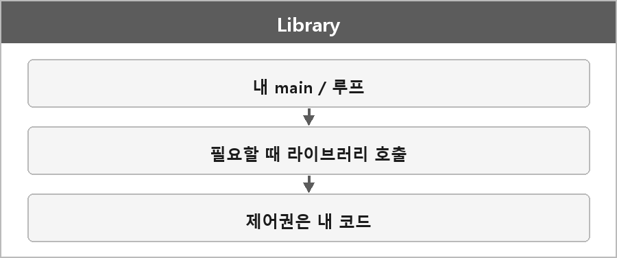

# 라이브러리

  

### 정의

특정 기능만 모아둔 **도구 상자**다.
내가 호출해서 쓰고, 제어 흐름은 여전히 내 코드가 가진다.

### 예시

| 라이브러리 | 용도 |
| --- | --- |
| FMOD, OpenAL | 사운드 재생 |
| DirectXTex, stb_image | 이미지 로드 |
| Box2D | 2D 물리 |

### 장단점

| 항목 | 설명 |
| --- | --- |
| **장점** | 필요한 기능만 가져다 쓸 수 있다 |
| **단점** | 여러 개를 연결하면 호환성과 구조 관리가 어려움 |

비교하면 그냥 내가 제어하고, 필요한 기능만 꺼내 쓰는 도구다.

게임 개발 흐름으로 보면 DirectXTex로 텍스처 로드하고 FMOD로 음악 재생하는 쪽이 라이브러리다.

---

> [!WARNING]
> **더 보충이 필요한 부분**
>
> 라이브러리 / 프레임워크 / API를 한 문장으로 가르는 국제 표준 정의는 없다.
> ISO/IEC 2382에 "library"가 나오긴 하는데, 면접에서 말하는 그 구분(누가 메인 루프를 도느냐)까지는 안 적어 둔다.
> 지금은 내가 정리한 제어 흐름 기준으로 두는 게 맞고, 표준 문장까지 외울 필요는 아직 없다.
