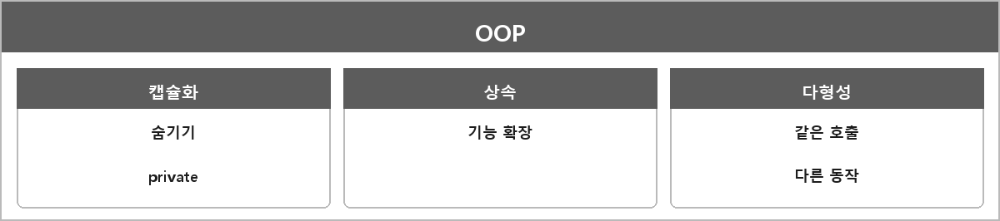

# 객체지향 프로그래밍

  

> 데이터와 이를 처리하는 함수(메서드)를 객체라는 단위로 묶어 캡슐화, 상속, 다형성 등을 활용하는 방식이다.
>
> 상속을 통해 공통 기능을 확장할 수 있고, 다형성을 통해 다양한 객체를 동일한 인터페이스로 사용할 수 있다.

내가 정리한 한 줄:
- OOP: 상속 구조를 통해 기능을 확장하는 것.
- ECS: 데이터를 컴포넌트로 관리하고 시스템이 이를 처리하는 구조.

캡슐화는 묶는 게 아니라 숨기는 것. Class.md에 같다.

---

> [!WARNING]
> **더 보충이 필요한 부분**
>
> 추상화도 객체지향 특성으로 자주 꼽힌다. 정리 본문엔 캡슐화/상속/다형성 위주다.
> 추상화는 "불필요한 세부사항을 감추고 필요한 면만 드러낸다"인데, 인터페이스/추상클래스가 그 수단이다.
> 지금은 Class.md, Pure-Virtual-Abstract-Interface.md랑 같이 보면 된다.
> ECS 상세(SoA, 아키타입)는 정리에 없으니 면접에서 ECS를 깊게 물어보면 따로 적어야 한다.
