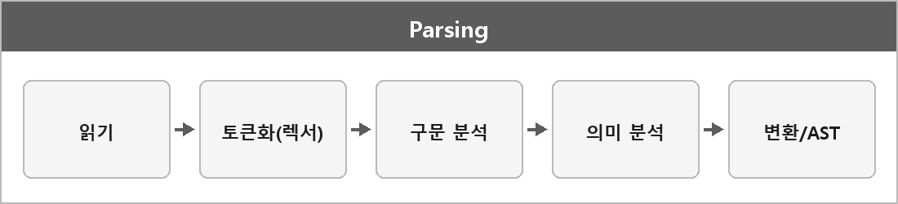

# 파싱

  

> 입력된 데이터를 컴퓨터가 이해하고 처리할 수 있는 형태로 바꾸는 과정이다.
>
> 예: `"1 2 3"` 문자열 → `int 1`, `int 2`, `int 3`

정리하면 문자열을 토큰으로 나누고, 문법과 의미를 검사한 뒤, 실행 가능한 구조로 바꾸는 전 과정이다.

## 순서

| 단계 | 하는 일 |
| --- | --- |
| **읽기** | 입력 문자열을 받는다 |
| **토큰화 (렉서)** | 의미 단위로 쪼갠다. `"1 + 1 = x"` → 숫자, 연산자, 식별자. 문자열 리터럴, 주석, 공백도 여기서 |
| **구문 분석** | 토큰이 문법에 맞게 배치됐는지. 틀리면 여기서 오류 |
| **의미 분석** | 문법은 맞는데 내용이 타당한지. 타입, 미정의 값, 시스템 규칙 |
| **변환** | AST, 객체, 내부 자료구조로 만든다 |

---

> [!NOTE]
> **보충**
>
> **출처:** Dragon Book (Aho et al., Compilers) 프론트엔드 단계.
>
> ISO C++ 번역 단계 `[lex.phases]`는 전처리 포함 9단계라서, 내가 적은 파싱 파이프라인과 1:1은 아니다.
> 게임 데이터/텍스트 파싱 설명으로는 렉서-파서-의미분석 구분이 맞다.

---

> [!WARNING]
> **더 보충이 필요한 부분**
>
> 재귀 하강, LL/LR 같은 파서 종류는 정리에 없다. 컴파일러를 직접 안 만들면 지금은 필요 없다.
> 파일 포맷(JSON) 파싱이랑 언어 파싱을 같은 말로 쓰면 범위가 넓어지니까 `JSON.md`를 따로 둔다.
