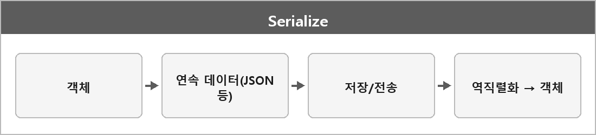

# 직렬화

  

> 클래스나 객체를 연속적인 데이터 형식으로 변환하여 저장하거나 전송할 수 있게 만드는 과정. 다시 되돌리는 것을 역직렬화라고 한다.

유니티에서는 직렬화로 설정하면 인스펙터 창에서 관리할 수 있게 된다.
게임 데이터의 저장/로드, JSON 파일로의 저장, 네트워크 전송 등을 할 때 사용된다.

---

> [!WARNING]
> **더 보충이 필요한 부분**
>
> 바이너리 vs 텍스트, 버전 호환, 포인터/그래프 직렬화는 정리에 없다.
> 네트워크나 세이브 파일을 말하면 이 문제가 바로 나온다.
> 유니티 쪽은 Unity 매뉴얼 Script Serialization을 보고 규칙(직렬화되는 필드 조건)을 보충해야 한다.
> 이유는 유니티가 public 필드, [SerializeField], 특정 타입만 직렬화해서다.
