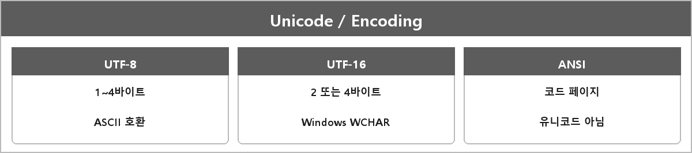

# 유니코드

  

> 원 정리에 본문이 없고, UTF-8, UTF-16, ANSI를 설명할 수 있어야 한다고만 적혀 있다.

---

> [!WARNING]
> **더 보충이 필요한 부분**
>
> 무엇:
> - 유니코드: 문자에 코드 포인트를 부여하는 표준 (Unicode Standard, unicode.org)
> - UTF-8: 1~4바이트 가변, ASCII 호환
> - UTF-16: 2 또는 4바이트. Windows WCHAR가 이쪽
> - ANSI: 윈도우에서 말하는 그거는 유니코드가 아니라 코드 페이지 기반 멀티바이트
>
> 왜 필요: WinMain/와이드 문자, 한글 깨짐이랑 바로 연결된다.
>
> 지금은 Unicode Standard / RFC 3629(UTF-8)를 보고 다시 적어야 한다.
