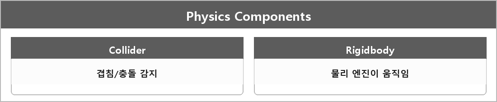

# 콜라이더 / 리지드바디

  

> 콜라이더는 충돌 감지를 위한 컴포넌트이며, 게임 오브젝트가 다른 게임 오브젝트와 충돌하는 것을 감지하고, 이에 대한 이벤트를 발생시킨다.
>
> 리지드바디는 물리엔진과 상호작용하기 위한 컴포넌트다.
>
> 물리 엔진에서 게임 오브젝트의 물리적인 움직임을 제어하며, 콜라이더와 함께 사용하여 게임 오브젝트 간 충돌 및 반응을 구현한다.

콜라이더만 있으면 트리거/겹침 감지.
리지드바디가 있어야 물리 시뮬레이션으로 밀린다.
Is Trigger면 물리 반응 없이 이벤트만.
