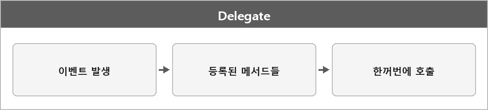

# 유니티 델리게이트

  

> 메서드의 참조를 저장할 수 있는 형식으로, 함수 포인터와 유사한 역할을 한다.
>
> 특정 작업을 유연하게 연결할 수 있다.
>
> 플레이어가 피해를 입었을 때 여러 메서드를 호출하고 싶다면 델리게이트에 해당 메서드들을 등록해 한 번에 처리할 수 있다.
>
> 이벤트 시스템에서도 많이 쓰이고, 결합도를 낮춘다.
>
> 게임 내 이벤트 처리, 버튼 클릭 시의 액션 설정 등.

C++ std::function이랑 역할이 비슷하다. 멀티캐스트면 여러 개 붙는 게 C# 델리게이트 기본이다.
