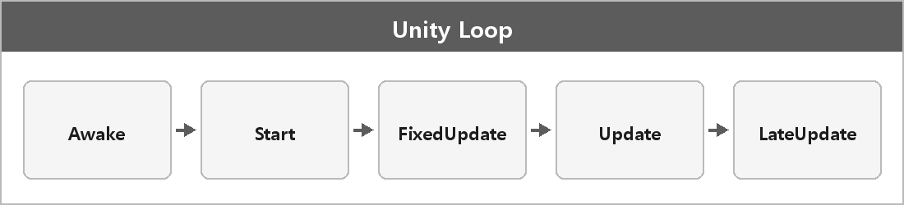

# Awake, Start, FixedUpdate, Update, LateUpdate

  

> 호출 순서를 섞으면 NullReference가 난다.
> 참조는 Awake에서 자기 거, 남 거는 Start에서.

## 호출 순서

| 함수 | 언제 | 메모 |
| --- | --- | --- |
| **Awake** | 스크립트가 로드되거나 오브젝트가 인스턴스화될 때 | 비활성이어도 불림. 같은 프레임끼리 순서 랜덤 |
| **Start** | 컴포넌트가 활성화되는 순간 | Awake보다 늦고, 첫 Update보다 빠름 |
| **FixedUpdate** | 고정 간격 | `Time.fixedDeltaTime`. 물리 |
| **Update** | 프레임마다 | |
| **LateUpdate** | Update 다음 | 카메라 추적 같은 거 |

## Awake

다른 오브젝트 **참조를 만들어 둘 때** 주로 쓴다.
다만 호출 순서가 제각각이라, 여기서 남의 스크립트를 참조하면 `NullReferenceException`이 날 수 있다.

## Start

참조를 통해 접근하는 작업은 여기서 한다.

---

> [!NOTE]
> **보충**
>
> - **출처:** Unity Manual — Event Functions, Execution Order of Event Functions
>
> Awake는 스크립트 인스턴스가 로드될 때. 비활성 오브젝트여도 호출된다고 매뉴얼에 있다.
> 같은 프레임 Awake들 사이의 순서를 가정하면 안 된다.
>
> FixedUpdate는 물리 스텝이라 프레임이랑 1:1이 아니다.
