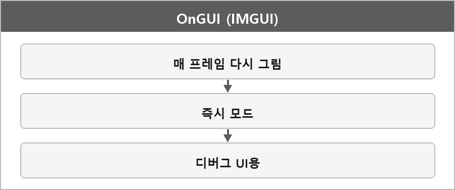

# OnGUI

  

> 유니티의 OnGUI는 IMGUI 시스템의 일부분으로, 런타임 중 UI를 생성하고 그리기 위한 메서드다.
>
> 디버그용 도구나 간단한 UI 요소를 빠르게 구현할 때 사용된다.
>
> OnGUI 메서드는 매 프레임마다 호출되며, GUI 요소를 화면에 그려주는 역할을 한다.
>
> 이 방식은 즉각적으로 UI를 생성하고 폐기하는 즉시 모드로, 씬 상태에 따라 UI가 동적으로 변화해야 할 때 유용하다.
>
> 다만, OnGUI는 매 프레임마다 UI를 다시 그리기 때문에 퍼포먼스가 좋지 않으며, 실질적인 게임 UI를 제작할 때는 Canvas 기반의 UI 시스템을 사용하는 것이 일반적이다.
>
> OnGUI는 주로 디버깅과 에디터 확장 용도로 적합하다.

---

> [!NOTE]
> **보충**
>
> - **출처:** Unity Manual — IMGUI
> 즉시 모드 GUI가 맞다. 게임 UI는 uGUI(Canvas)가 기본 권장이다.
