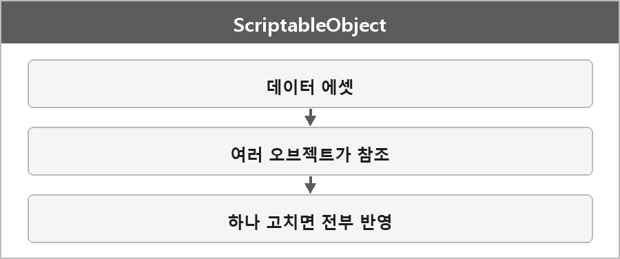

# ScriptableObject

  

> 데이터를 에셋 파일로 저장하고, 이를 재사용하거나 여러 오브젝트에서 공유할 수 있다.
>
> 게임의 데이터와 로직을 분리하는 데 유용하며, 특히 아이템 정보, 설정 값, 게임 내 캐릭터의 스탯 등을 저장할 때 자주 사용된다.
>
> 중복 데이터 사용을 줄이고 메모리 사용을 효율적으로 관리할 수 있다.
>
> 에디터에서 쉽게 수정할 수 있어 디자이너와 프로그래머 협업에 유리하다.
>
> 단점으로는 런타임 중 데이터 변경이 저장되지 않는다는 점이 있어, 게임 진행 중에 데이터를 영구적으로 변경할 필요가 있는 경우에는 신중히 사용해야 한다.

ScriptableObject는 데이터를 에셋으로 저장해 여러 오브젝트에서 공유하고,
메모리를 절약하며 유지보수가 쉽도록 해주는 Unity의 데이터 컨테이너다.
예를 들어 무기 스탯이나 타일맵 설정 같은 공용 데이터를 ScriptableObject로 관리하면,
하나만 수정해도 모든 참조 객체에 적용된다.

웨이브 패턴 값이 STO에 저장된 값과 일치하면 소환한다는 게 이 용도다.

---

> [!NOTE]
> **보충**
>
> - **출처:** Unity Manual — ScriptableObject
> 에셋으로 존재하고 씬 오브젝트와 독립적이다.
> 런타임 변경은 기본적으로 디스크에 안 남는다. 플레이 모드에서 바꾼 값이 에디터 에셋에 묻으면 사고다.
