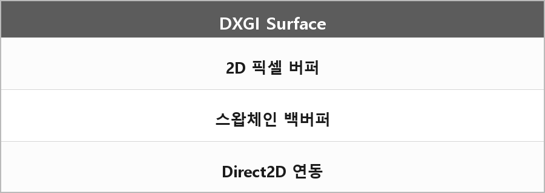

# DXGI Surface

  

> [!TIP]
> **여담**
>
> DXGI Surface는 DirectX에서 픽셀 데이터를 담는 2D 버퍼로, 스왑체인 백버퍼나 Direct2D와 연동할 때 사용된다.
>
> 본문 정리는 이 한 줄이 전부다.

---

> [!NOTE]
> **보충**
>
> - **출처:** Microsoft Learn — IDXGISurface
> 2D 픽셀 버퍼 인터페이스가 맞다.
> 스왑체인 백버퍼를 표면으로 얻어서 D2D에 넘기는 패턴이 공식 샘플에 있다.

---

> [!WARNING]
> **더 보충이 필요한 부분**
>
> 포맷, CPU 접근(Map), 멀티샘플 표면 차이는 정리에 없다.
> Direct2D 연동을 면접에서 그리라고 하면 그 코드가 필요하다. DXGI/D2D 상호운용 문서를 보고 적어야 한다.
