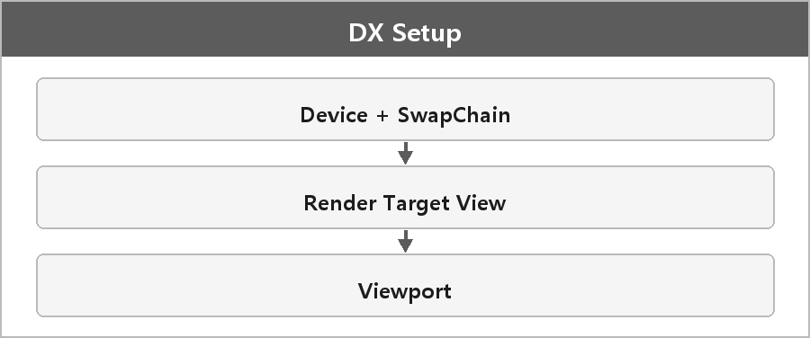

# DirectX 기본 설정

  

> 디바이스, 스왑체인, 렌더 타겟 뷰, 뷰포트.

그래픽 장치와 화면 출력을 설정한다.
첫 번째는 디바이스와 스왑체인을 생성하는 것이다.
디바이스는 GPU와의 통신을 관리하고, 스왑체인은 이중 버퍼링을 통해 렌더링 결과를 화면에 출력한다.
다음으로 렌더 타겟 뷰를 설정하여 출력할 프레임 버퍼를 지정한다.
마지막으로 뷰포트를 설정하여 렌더링 영역을 정의한다.

이 과정을 통해 화면에 원하는 장면을 GPU에서 처리하고 출력할 수 있는 기초 설정을 마친다.

렌더링이 제일 어려웠고 DirectX 예제랑 강의를 보면서 풀었다.
