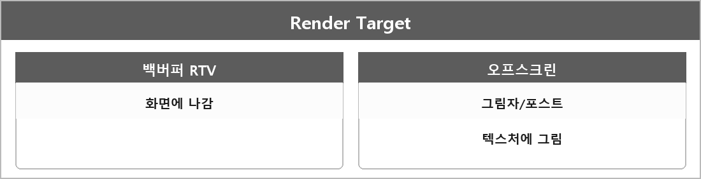

# Render Target

  

> [!TIP]
> **여담**
>
> 렌더 타겟은 GPU가 그린 결과를 저장하는 버퍼로, 기본은 화면 출력용 백버퍼이고 그림자맵 같은 오프스크린 렌더링에도 쓰인다.

> [!TIP]
> **여담**
>
> 오프스크린 렌더링은 화면 대신 텍스처 같은 버퍼에 그려서 그림자, 반사, 포스트 프로세싱 등에 활용하는 기법이다.
>
> D3D11에선 ID3D11RenderTargetView가 그 버퍼를 OM에 묶는 뷰다.

---

> [!NOTE]
> **보충**
>
> - **출처:** Microsoft Learn — Render Target View
> OM 단계가 픽셀을 쓰는 곳이 렌더 타겟이다.
> 백버퍼 RTV가 기본이고, 텍스처에 RTV를 만들면 오프스크린이다.
