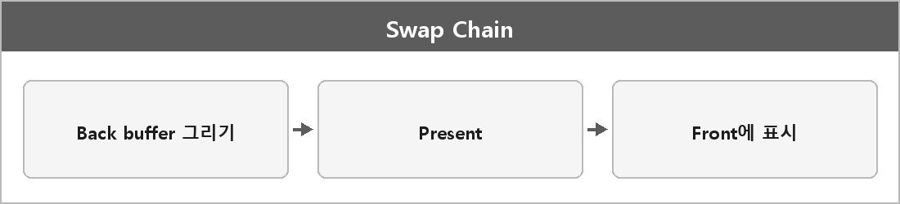

# 스왑체인

  

> GPU가 그린 프레임을 화면에 표시하기 위해 사용하는 백 버퍼와 프런트 버퍼 집합, DXGI에서 관리.

> [!TIP]
> **여담**
>
> 스왑체인은 DirectX에서 백 버퍼와 프론트 버퍼를 교체해 GPU가 그린 프레임을 화면에 표시하는 구조다.
>
> 더블 버퍼링을 DirectX가 객체로 만든 것에 가깝다.
> Present가 교체(또는 플리핑)다.

---

> [!NOTE]
> **보충**
>
> - **출처:** Microsoft Learn — DXGI Swap Chain
> DXGI가 출력 버퍼를 관리한다.
> 버퍼 개수, 플리핑 모델, vsync가 여기 옵션이다.
