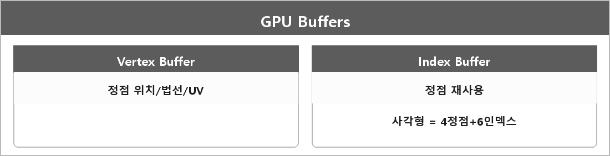

# Vertex Buffer / Index Buffer

  

> Vertex Buffer는 정점을 GPU에 저장해 효율적으로 그리기 위함이고, Index Buffer는 정점을 재사용해 메모리를 줄이고 성능을 높이기 위함이다.

사각형 두 삼각형은 정점 6개가 아니라 정점 4개 + 인덱스 6개로 간다.

Input Layout은 정점 데이터 구조를 GPU에 알려준다. (위치, 법선, UV가 몇 바이트 오프셋인지)
Vertex Shader는 정점 위치를 변환하고, Pixel Shader는 픽셀 색을 계산한다.
