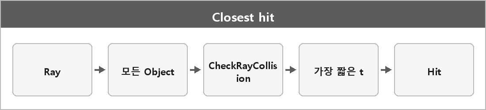

# Closest hit

  

> FindClosestCollision은 전달받은 광선이 장면에서 어떤 객체와 가장 먼저 만나는지 찾는 함수다.
>
> 모든 객체를 검사해 가장 짧은 충돌 거리를 가진 Hit 구조체를 반환하며, 여기엔 교차점, 법선, 텍스처 좌표 등 셰이딩에 필요한 정보가 담긴다.

레이트레이싱 1차(레이캐스트)의 구현이다.
가장 가까운 t를 고르는 거다.

연습 코드: [FindClosestCollision](../../Projects/그래픽스 연습/교차/FindClosestCollision.md)

---

### 내가 적을 칸

> _여기에_

---

> [!WARNING]
> **더 보충이 필요한 부분**
>
> 내가 안 적은 설명은 여기 넣지 않는다. 나중에 아래를 적어야 한다.

| 무엇 | 왜 | 볼 곳 |
| --- | --- | --- |
| closest-hit / any-hit | 1차는 가장 가까운 점, 그림자는 가리는지만 보면 됨 | Microsoft Learn [Closest-hit shader](https://learn.microsoft.com/en-us/windows/win32/direct3d12/closest-hit-shader), [Any-hit shader](https://learn.microsoft.com/en-us/windows/win32/direct3d12/any-hit-shader). PBRT [Rays](https://pbr-book.org/3ed-2018/Geometry_and_Transformations/Rays) |
