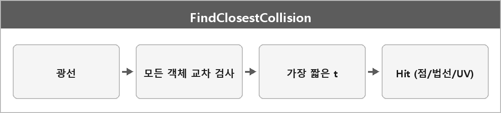

# FindClosestCollision

  

> FindClosestCollision은 전달받은 광선이 장면에서 어떤 객체와 가장 먼저 만나는지 찾는 함수다.
>
> 모든 객체를 검사해 가장 짧은 충돌 거리를 가진 Hit 구조체를 반환하며, 여기엔 교차점, 법선, 텍스처 좌표 등 셰이딩에 필요한 정보가 담긴다.

레이트레이싱 1차(레이캐스트)의 구현이다.
가장 가까운 t를 고르는 거다.
