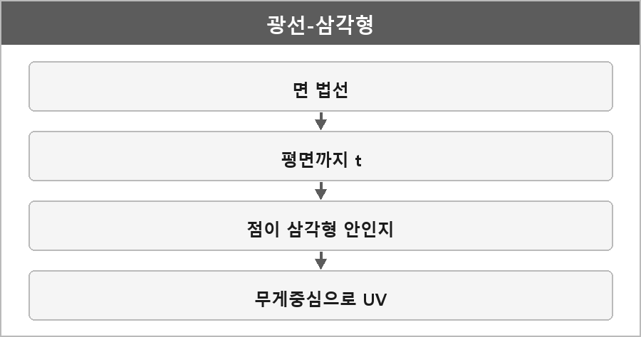

# 광선-삼각형 교차

  

연습 코드: [Triangle CheckRayCollision](../../Projects/그래픽스 연습/교차/Triangle.md)

---

### 내가 적을 칸

> _여기에_

---

> [!WARNING]
> **더 보충이 필요한 부분**
>
> 내가 안 적은 설명은 여기 넣지 않는다. 나중에 아래를 적어야 한다.

| 무엇 | 왜 | 볼 곳 |
| --- | --- | --- |
| 광선–평면 교차 (\(t\) 공식) | 삼각형 검사 전에 평면까지 거리를 구함 | Wikipedia [Line–plane intersection](https://en.wikipedia.org/wiki/Line%E2%80%93plane_intersection) |
| 점이 삼각형 안인지 / 무게중심 좌표 | UV 보간에도 씀 | Wikipedia [Barycentric coordinate system](https://en.wikipedia.org/wiki/Barycentric_coordinate_system) |
| 이 코드 vs Möller–Trumbore | 같은 알고리즘인지 구분해 적어야 함 | Wikipedia [Möller–Trumbore intersection algorithm](https://en.wikipedia.org/wiki/M%C3%B6ller%E2%80%93Trumbore_intersection_algorithm), Möller & Trumbore, *Journal of Graphics Tools* 1997 |
