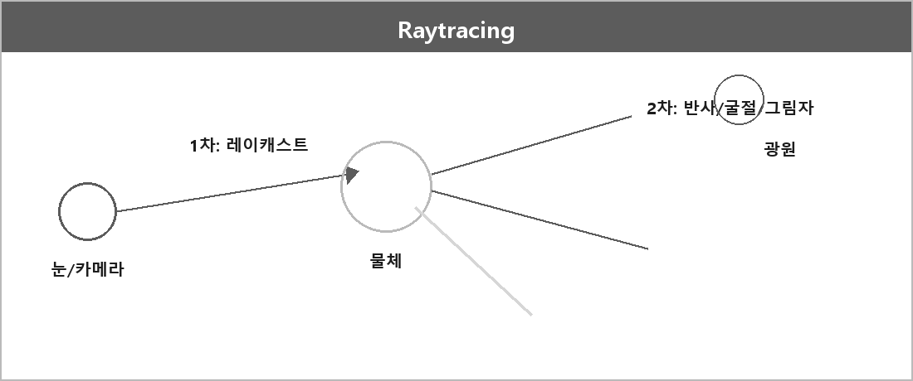

# 레이트레이싱

  

> 시점에서 Ray를 쏘아 물체와의 교차점을 찾고, 그 지점에서 반사·굴절을 추적해서 그림자와 반사를 표현하는 기술이다.
>
> 포트폴리오에는 퐁 셰이딩과 그림자 구현에 썼다.

시점은 그냥 **레이캐스팅**이다. 보이는 부분이 어딘지 결정하는 광선만 쏜다.
캐스팅이랑 다른 점은, 부딪힌 교차점에서 배보다 배꼽이 큰 거마냥 새 광선을 와다다닥 쏜다는 거다.

1차 / 2차 / 3차 구분은 **설명용**이다. 실제로는 2차 이상이 그냥 N차다.

## 단계

| | 하는 일 |
| --- | --- |
| **1차** | 시점에서 물체에 부딪힐 때까지 광선을 쏜다. 이것만 하면 Raycasting |
| **2차** | 교차점 재질·반사를 보려고 광선을 마구 쏜다 |
| **3차~** | 그 광선이 또 물체에 맞고, 또 쏘고. 반복 |

2차 예: 거울에 맞으면 반사각으로 반사 광선을 내보낸다.
그 광선이 또 물체에 맞으면 교차점을 또 만든다.
정해진 횟수, 또는 더 맞을 물체가 없을 때까지 (게임 시야보다 좀 더 넓은 범위) 한-무 반복.

교차점에서 나가는 것들:

- Shadow Ray
- Reflection ray
- AO ray
- Indirect Illumination ray
- Light sampling ray

그 방향에 있는 물체가 처맞으면서 또 이런 Ray를 쏜다.

> [!TIP]
> **현실 vs Raytracing**
>
> 흔히 재귀적으로 광선을 쏜다고 한다. 현실에서 물체를 인식하는 거랑 반대다.
>
> | | 경로 |
> | --- | --- |
> | 현실 | 광원 → 물체 → 눈 |
> | Raytracing | 눈 → 물체 → 광원 |

## 2차에서 나가는 광선

여담 2~3은 전부 2차에 속한다.
1차에 캐스팅 당한 물체에서 "히히! 갈겨!" 하고 쏘는 건 전부 2차다.

### Reflect Ray

교차점에서 나가는 것 중 하나.
방향은 반사/굴절 법칙.
거울이거나 물 같은 투명 재질의 내외부 시야 계산용으로 2차 때 나간다.

### AO ray — 주변 폐쇄도

구조적 음영 같은 것.
앰비언트 오클루전 → 어두운 데는 어둡게, 밝은 데는 밝게.
위에 지붕 있냐 없냐.
실내면 집 없는 거보다 어둡겠지.
게임에서 밖은 겁나 밝은데 실내 들어가면 확 어두워지는 그게 그거다.

### Indirect Illumination — 간접광

안 하면 직접광(태양 같은 거)만 계산한다.
하면 물체에서 반사된 것도 광원으로 쳐서 더 자연스럽다.

### Light sampling — 광원 샘플링

광원이 한 점/픽셀에 미치는 영향을 계산하려고,
세기와 방향을 규칙·분포에 따라 여러 번 샘플링한다.

> 솔직히 뭔 말인지 모르겠다. 다시 적을 거다.

### Shadow ray — 그림자

교차점에서 광원을 향해 쏜다. 사이에 다른 물체가 가로막나 체크.
Hit 여부만 본다. **재귀 검사 안 한다.**

## OpenMP

각 픽셀을 독립적으로 계산해서 병렬화 효율이 높다.
OpenMP로 루프를 병렬화하면 CPU 코어를 다 써서 렌더링 시간을 줄일 수 있다.

## 노말맵이랑 차이

| 항목 | 설명 |
| --- | --- |
| 노말맵 라이팅 | 텍스처의 가짜 법선으로 표면 디테일을 빠르게 |
| 레이트레이싱 | 광선을 추적해서 반사·굴절 같은 빛 효과를 계산 |

---

> [!WARNING]
> **더 보충이 필요한 부분**
>
> 내가 안 적은 설명은 여기 넣지 않는다. 나중에 아래를 적어야 한다.

| 무엇 | 왜 | 볼 곳 |
| --- | --- | --- |
| 눈에서 쏘는 이유, 반사/굴절/그림자 광선 | 원문은 여담으로만 있음 | Whitted, "An Improved Illumination Model for Shaded Display", CACM 1980 |
| Reflect Ray 방향 | 원 정리에 **굴절 법칙**이라고 적음. 반사와 굴절을 나눠 적어야 함 | Wikipedia [Specular reflection](https://en.wikipedia.org/wiki/Specular_reflection), [Snell's law](https://en.wikipedia.org/wiki/Snell%27s_law), [Ray tracing (graphics)](https://en.wikipedia.org/wiki/Ray_tracing_(graphics)) |
| 광원 샘플링 | 원문에 다시 적겠다고 함. 공식 한 줄로 안 끝남 | PBRT Light Sampling 챕터 |

---

## 연습 코드

이론은 이 폴더. 코드는 [그래픽스 연습](../../Projects/그래픽스 연습/그래픽스 연습.md).
