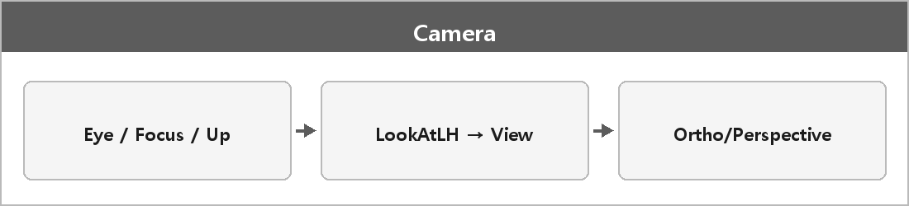

# Camera (월드 변환, UpdateView)

  

> SetTarget을 하면 카메라가 target으로 지정된 객체를 추적하여 따라간다.
>
> target이 없더라도 F3키를 누르면 카메라를 이동할 수 있게 된다.
>
> 또한 카메라는 월드 변환과 카메라 변환을 수행한다.

XMMatrixLookAtLH : 카메라 위치·시선·업 벡터를 기준으로 뷰 행렬을 만든다. 월드 → 뷰.
XMMatrixOrthographicOffCenterLH : 정해둔 평면 박스 영역을 스크린으로 평행 투영하는 행렬.

LookAt 방향은 View-Projection.md 보충을 따른다. 원 노트에 적힌 화살표는 반대였다.
