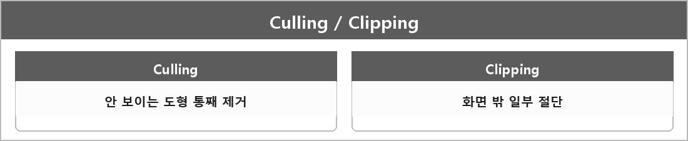

# Culling / Clipping

  

> Culling은 보이지 않는 도형을 통째로 제거하는 과정이고, Clipping은 화면 밖으로 나간 도형의 일부를 잘라내는 과정이다.

백페이스 컬링은 카메라를 등진 삼각형을 버린다.
클리핑은 래스터라이저 전에 뷰 프러스텀 밖으로 나간 부분을 자른다. 파이프라인 RS 설명에 있다.

---

> [!WARNING]
> **더 보충이 필요한 부분**
>
> 프러스텀/오클루전 컬링 구현은 정리에 없다.
> 면접이 "어떻게 했냐"면 그 구분이 필요하다. Direct3D 래스터화 규칙 문서를 보면 클리핑은 파이프라인 고정 단계다.
