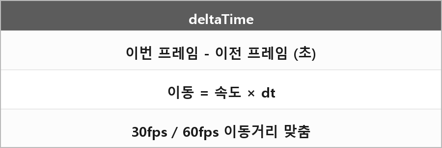

# deltaTime

  

> 델타 타임은 이전 프레임과 현재 프레임 사이에 걸린 시간이다.
>
> (예: 1/60, 1/30) 이게 필요한 이유는 컴퓨터 성능에 따라 캐릭터가 더 빨리 움직인다는 등의 문제를 해결하기 위해 일관된 기준이 필요하기 때문이다.

정리하자면
deltaTime은 프레임 간 경과 시간을 초 단위로 나타낸 값이다.
이걸 이용하면 컴퓨터 성능, FPS와 관계없이 동일한 게임 속도를 유지할 수 있게 된다.

> [!TIP]
> **여담**
>
> 고급지게 말하는법
> 델타 타임은 프레임간 경과 시간으로 오브젝트 이동이나,
> 애니메이션 속도를 프레임레이트와 무관하게 일정하게 유지해준다.
>
> 예를 들자면 30fps와 60fps 환경 모두에서 동일한 이동거리를 보장하기 위해 필요하다.
>
> 재는 시계는 steady_clock이 맞다. Chrono.md.
